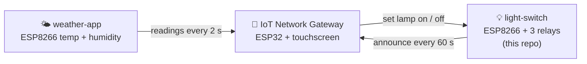
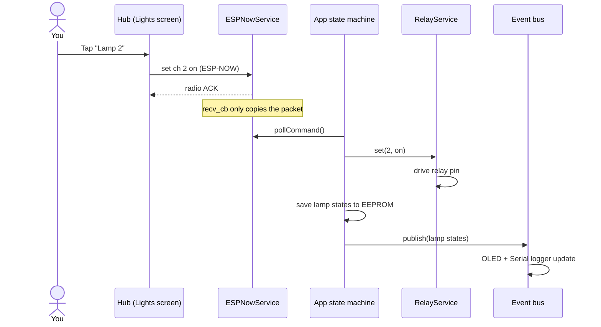
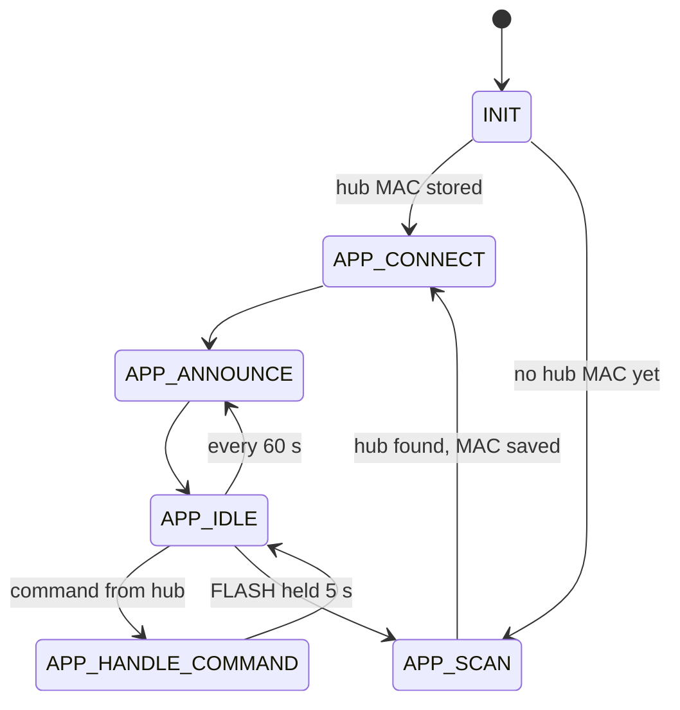

<div align="center">

# 💡 ESP8266 Light Switch

### Three lamps, one tap on the wall screen, zero cloud.

Firmware for an **ESP8266 relay board** that switches **3 lamps** on command from the
[**IoT Network Gateway**](https://github.com/dalilawini/iot-network-gateway) touchscreen hub, over **ESP-NOW**.


</div>

---

## 🏡 Part of a bigger system

This board is one node of a small smart-home network. The hub does the talking, the nodes do the work.



| Repository | Role |
|---|---|
| [iot-network-gateway](https://github.com/dalilawini/iot-network-gateway) | The hub: dashboard, pairing, device list, **Lights** screen |
| [weather-app](https://github.com/dalilawini/weather-app) | Temperature/humidity node (same architecture as this one) |
| **light-switch** | This repo: the lamp relay board |

---

## ✨ Features

- 🔘 **3 relay channels**, switched individually or all at once from the hub
- 🔗 **Pairs itself**: finds the hub's `ESP-NOW…` access point, learns its MAC and remembers it
- 🛡️ **Only obeys its hub**: commands from any other MAC address are ignored
- 💾 **Survives power cuts**: lamp states are saved and restored at boot, so the hub's screen stays right
- 📺 **Optional OLED** (SH1106, 128×64) showing each lamp's state
- 🧩 **State machine + event bus**, same architecture as weather-app

---

## 📡 How it talks

Messages follow the hub's protocol ([full spec](https://github.com/dalilawini/iot-network-gateway/blob/main/docs/espnow-protocol.md)):
small JSON text over ESP-NOW on **channel 1**.

| Direction | Message | When |
|---|---|---|
| Switch → hub | `{"type":"switch","ch":3}` | right after connecting, then every 60 s |
| Hub → switch | `{"cmd":"set","ch":2,"on":true}` | every tap on the hub (`ch: 0` = all lamps) |

The switch doesn't send a reply. The hub uses ESP-NOW's **radio-level acknowledgement** to know whether the command
arrived, and shows ✓ or "Light switch did not answer" on its screen.



---

## 🔗 Pairing

1. On the hub, open **☰ → Devices → + Pair device** (the hub opens its access point for 60 s).
2. Power on the switch. With no hub stored yet, it scans, finds the `ESP-NOW…` network, connects and saves the hub MAC.
3. The hub switches back to ESP-NOW. The switch announces itself and appears in the hub's list with a **NEW** badge.
4. On the hub, tap it and choose **Bedroom**. The **Lights** screen now controls it.

**To pair again** (new hub, or moving to another one), **hold the FLASH button for 5 s** while the board is running.
Don't hold it while powering up, because that starts the bootloader instead.



---

## 🔌 Wiring (NodeMCU / Wemos D1 mini)

| Function | Board pin | GPIO |
|---|---|---|
| Relay 1 (Lamp 1) | D5 | 14 |
| Relay 2 (Lamp 2) | D6 | 12 |
| Relay 3 (Lamp 3) | D7 | 13 |
| OLED SDA (optional) | D2 | 4 |
| OLED SCL (optional) | D1 | 5 |
| Pair button | FLASH | 0 |
| Status LED | D0 | 16 |

Relays are **active LOW** by default, which suits most relay modules. If your module switches on a HIGH input,
set `ACTIVE_LOW = false` in [`relays/RelayService.h`](relays/RelayService.h).

> ⚠️ **Mains voltage can kill.** The lamp side of the relays carries 230 V / 110 V. Use a properly rated, enclosed
> relay module, keep low-voltage and mains wiring apart, and have a qualified person check the installation.

---

## 🧩 Project structure

```text
light-switch/
├── light-switch.ino          ← entry point, #includes every module
├── app/
│   ├── App.*                 ← state machine: init, scan, connect, announce, handle commands
│   ├── Event.*               ← event bus: "lamp states changed"
│   └── Logger.*              ← Serial output
├── relays/RelayService.*     ← drives the 3 relay pins
├── wireless/ESPNowService.*  ← pairing scan, ESP-NOW announce + command receive
├── storage/EEPROMStorage.*   ← hub MAC + lamp states
├── display/OLEDService.*     ← optional SH1106 status screen
└── io/IO.*                   ← FLASH button (hold to re-pair), status LED
```

---

## 🛠️ Build and flash

Needs the **ESP8266 Arduino core 3.1.x** and the libraries **ArduinoJson 7** and **Adafruit SH110X**.

```bash
arduino-cli compile --fqbn esp8266:esp8266:nodemcuv2 \
  --build-property compiler.cpp.extra_flags="-Iapp -Idisplay -Iio -Irelays -Iwireless -Istorage" .

arduino-cli upload -p COM5 --fqbn esp8266:esp8266:nodemcuv2 .
arduino-cli monitor -p COM5 -c baudrate=115200
```

Use `esp8266:esp8266:d1_mini` for a Wemos D1 mini.

Every push and pull request is built by GitHub Actions. Tag a version (`v1.0.0`) to publish a ready-to-flash
`light-switch.bin` on the **Releases** page.

---

## ⚙️ Configuration

| What | Where | Default |
|---|---|---|
| Number of relays | `RELAY_COUNT` in `relays/RelayService.h` | 3 |
| Relay pins | `pins[]` in `relays/RelayService.h` | GPIO 14, 12, 13 |
| Relay polarity | `ACTIVE_LOW` in `relays/RelayService.h` | `true` |
| Announce interval | `ANNOUNCE_INTERVAL` in `app/App.h` | 60 s |
| ESP-NOW channel | `ESPNOW_CHANNEL` in `wireless/ESPNowService.h` | 1 (must match the hub) |

---

## 📄 License

Creative Commons Attribution-NonCommercial 4.0 International (CC BY-NC 4.0). See [`LICENSE`](LICENSE).

<div align="center">

Made by [@dalilawini](https://github.com/dalilawini)

</div>
